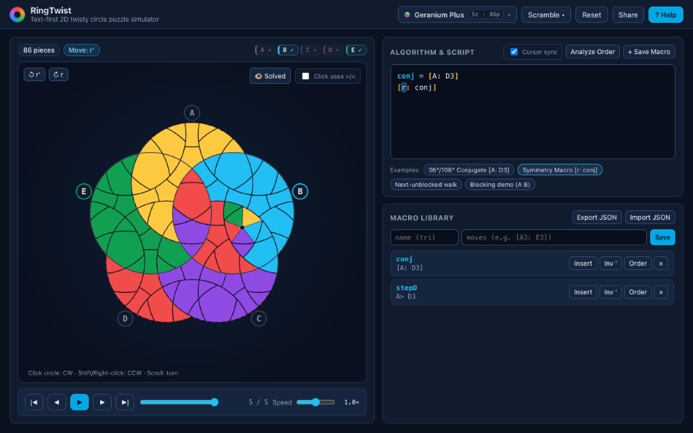

# RingTwist

A **text-first 2D twisty circle puzzle simulator** built for exploring and solving **non-doctrinaire (blocking / bandaged)** circle puzzles like the VeryPuzzle Geranium Plus.

**Live demo:** [joshmermelstein.com/ringtwist](https://joshmermelstein.com/ringtwist/) · **License:** [MIT](LICENSE)



Inspired by [Twizzle](https://alpha.twizzle.net/explore/?puzzle=3x3x3) for algorithm notation/playback and [GeraniumsPot](https://github.com/grigorusha/GeraniumsPot/) for exact 2D circle-puzzle geometry — running 100% client-side in the browser with **zero runtime dependencies**.

---

## Features

- **Analytical 2D Arc-Region Geometry**: Exact circular-arc piece representation (`ArcRegion`), planar DCEL circle slicing, analytical Green's-theorem areas, and zero-drift canonical snapping across 600+ move round-trips.
- **Twizzle-Style Notation & Non-Doctrinaire Execution**:
  - Fixed stop turns (`A`, `A2`, `A'`), next-unblocked alignment (`A>`, `A<`), and whole-puzzle symmetry rotations (`r`, `r'`) that keep spatial labels `A..Z` fixed on screen.
  - Commutators `[X, Y]`, conjugates `[X: Y]`, grouping & repeats `(X)3`, algebraic inverses `(...)'`, inline macros `name = expr`, and line comments (`//`, `#`).
  - Stops immediately before a blocked move, underlines the offending token in the editor, and highlights the target circle and every straddling piece on the canvas.
- **Group-Theory Fast-Forward & Order Analyzer**: Detects shape-preserving permutations (jumping huge repeats in $O(n)$ via cycle powers with exact `BigInt` prime-factor order reduction) and state-hash cycles, plus one-click **Analyze Order** for any algorithm, selection, or macro.
- **Macro Library & URL Sharing**: Save reusable macros per puzzle (`localStorage`), import/export JSON, and share puzzles + algorithms + macros via live URL hashes (`#p=...`).
- **Seeded Scrambles & Solved Reference**: Deterministic seeded scramble generator (numeric or word seeds) and a toggleable **👁 Solved** reference overlay.
- **Playback & Auxiliary Mouse Input**: Scrubber, step/play/pause, logarithmic `0.25×–4.0×` speed control, cursor-synced preview, and optional click/trackpad-smoothed wheel input with automatic move coalescing and cancellation (`B` + `B'` cancels, `B` + `B` → `B2`).

---

## Included Puzzles

### Geranium Family
| Puzzle | Circles | Pieces | Stops |
| --- | :---: | :---: | --- |
| **Geranium Plus** | 5 | 86 | 36° (10 stops) |
| **Geranium (Standard)** | 5 | 71 | Uneven `(36°, 72°, ...)` |
| **Super Geranium Plus** | 10 | 196 | Inner 36° / Outer uneven |
| **Super Geranium** | 10 | 156 | Uneven `(36°, 72°, ...)` |
| **Pocket Geranium** | 3 (in a line) | 60 | Uneven `(108°, 36°, ...)` |
| **Mini Geranium Plus** | 2 | 56 | Uneven `(108°, 36°, ...)` |
| **Mini Geranium** | 2 | 46 | Uneven `(108°, 36°, ...)` |

### Classic Circles
| Puzzle | Circles | Pieces | Stops |
| --- | :---: | :---: | --- |
| **2-Circle Venn (Mandorla)** | 2 | 21 | 120° (3 stops) |
| **Twin Rings** | 2 | 67 | 90° (4 stops + inner rings) |
| **4-Circle Clover** | 4 | 16 | 90° (4 stops) |
| **6-Circle Hex Flower** | 6 | 66 | 60° (6 stops) |

---

## Notation Quick Reference

```text
// Comments start with // or #
conj = [A: D3]          // Inline macro: A D3 A'
[r: conj]               // Conjugate by 1 whole-puzzle rotation CW (72° on Geranium)
[A3, E3]2               // Commutator repeated twice: (A3 E3 A3' E3')2
(A> D3 A')'             // Next-unblocked move (>) and algebraic inverse (')
```

- `A`, `B`, `C`, … — Turn the circle **1 stop clockwise** (`A2` = 2 stops, `A'` = 1 stop CCW).
- `A>`, `A<` — Turn CW (`>`) or CCW (`<`) to the **next stop where an overlapping neighbor becomes unblocked**.
- `r`, `r'` — Rotate the entire puzzle by 1 symmetry step CW/CCW (spatial labels stay fixed).
- `[X, Y]` = `X Y X' Y'` (commutator); `[X: Y]` = `X Y X'` (conjugate).

---

## Development

```bash
npm install
npm run dev      # Start local Vite dev server (http://localhost:5173/)
npm test         # Run geometry, catalog, notation, and coalescing tests (Vitest)
npm run build    # Type-check and build static bundle into dist/
```

## Deploying to GitHub Pages

A GitHub Actions workflow is included at [`.github/workflows/deploy.yml`](.github/workflows/deploy.yml).

1. Create the repository on GitHub and push `main`:
   ```bash
   git remote add origin git@github.com:JoshMermel/ringtwist.git
   git push -u origin main
   ```
2. In your repository **Settings → Pages**, set **Source** to **GitHub Actions**.
3. Every push to `main` automatically runs tests, builds `./dist` (with relative `./` asset paths), and publishes to `https://joshmermelstein.com/ringtwist/`.

---

## Architecture & Adding Puzzles

See [`docs/ARCHITECTURE.md`](docs/ARCHITECTURE.md) for module responsibilities, core geometric/evaluator invariants, and a step-by-step guide to adding new puzzles.

- `src/geom/` — Analytical circular-arc geometry (`math.ts`, `arcRegion.ts`) and DCEL planar circle slicer (`slicer.ts`).
- `src/puzzle/` — Non-doctrinaire move/blocking engine (`engine.ts`), `GeraniumsPot` script runner (`geraniumsPotScript.ts`), exact puzzle builders (`geraniumBuilder.ts`), and catalog (`catalog.ts`).
- `src/lang/` — Recursive-descent algorithm parser (`parser.ts`), AST (`ast.ts`), and non-doctrinaire evaluator with group-theory fast-forward (`evaluator.ts`).
- `src/ui/` — Animated SVG renderer & static thumbnails (`svgRenderer.ts`), syntax-highlighted editor (`editor.ts`), visual puzzle picker (`puzzlePicker.ts`), interactive move coalescing (`moveCoalesce.ts`), help modal (`helpModal.ts`), and `localStorage`/URL-hash storage (`storage.ts`).

---

## Acknowledgments

- **[Twizzle](https://alpha.twizzle.net/)** for pioneering clean web-based twisty puzzle notation and playback UX.
- **[VeryPuzzle](https://www.verypuzzle.com/)** for designing the physical Geranium, Geranium Plus, Super Geranium, Pocket Geranium, and Mini Geranium puzzles.
- **[GeraniumsPot](https://github.com/grigorusha/GeraniumsPot/)** and **[twisty-puzzles-2d](https://github.com/gloomyswan/twisty-puzzles-2d)** for the `.txt` puzzle construction scripts and geometric reference.

## License

MIT © 2026 Josh Mermelstein — see [`LICENSE`](LICENSE).
